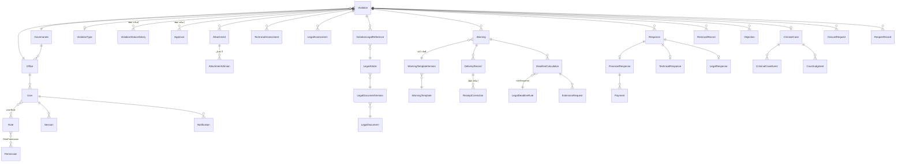

# نموذج البيانات

المخطط الكامل في `prisma/schema.prisma`، والترحيلات في `prisma/migrations/`. المخطط مصمَّم من الجزء الأول لكل المراحل، حتى لا تتغير البنية جذرياً لاحقاً.

## الحقول الثلاثة المستقلة للمخالفة

| الحقل | القيم | المعنى |
|---|---|---|
| `generalStatus` | `OPEN`, `CLOSED` | الحالة العامة |
| `stage` | 24 مرحلة (`DRAFT` … `CLOSED`) | الإجراء الذي وصلت إليه المعاملة |
| `outcome` | استجابة مالية/فنية/قانونية، إزالة كاملة، عدم استجابة ودعوى، اعتراض، عدم موافقة، أخرى | المسار النهائي (فارغ حتى يتحدد) |

## مخطط العلاقات (الكيانات الرئيسية)



## القواعد

- **المعرّفات:** معرّفات داخلية `cuid`. الأرقام الرسمية (`Violation.number` و`Warning.number` و`CriminalCase.number`) حقول مستقلة بقيد فريد.
- **الترقيم:** جدول `NumberingSequence` يُزاد ذرياً بعملية `INSERT … ON CONFLICT DO UPDATE … RETURNING` داخل المعاملة، فلا تتكرر الأرقام مع الطلبات المتزامنة (اختبار بأربعين طلباً متزامناً). الصيغة قابلة للتهيئة: `{YYYY}` و`{GOV}` و`{OFFICE}` و`{SEQ:n}`. يبدأ تسلسل مستقل لكل سنة أو محافظة أو مكتب بحسب الرموز الموجودة في الصيغة، والسنة تُحتسب بتوقيت بغداد.
- **عدم الحذف:** جميع العلاقات الرسمية `onDelete: Restrict`، والأرشفة منطقية (`archivedAt` و`withdrawnAt`). الاستثناء الوحيد هو جلسات الدخول والإشعارات، إذ تُحذف بحذف المستخدم.
- **حماية على مستوى قاعدة البيانات** (الترحيل `audit_immutability`): مشغّلات تمنع `UPDATE` و`DELETE` و`TRUNCATE` على `AuditLog`، وتمنع التعديل والحذف على `ViolationStatusHistory` و`Approval` و`ReceiptCorrection`. محتوى `AttachmentVersion` لا يُعدَّل، ويُسمح فقط بتحديث حالة الفحص.
- **التزامن:** `Violation.version` للحماية من التعديل المتزامن (تحقق تفاؤلي في الأجزاء القادمة).
- **المبالغ:** `Decimal(18,2)`. المبلغ المستحق يُدخل يدوياً مع سنده (`amountDueBasis`)، ولا يحتسبه النظام.
- **الفهارس:** على النطاق (`governorateId` و`officeId`)، والمرحلة، والحالة، والجهة المخالفة، ورقم الإجازة، ورقم المحضر، ورقم الكتاب، وتاريخ التسجيل، وحالة المدة وتاريخ استحقاقها، والإشعارات غير المقروءة.
- **البيانات التجريبية:** حقل `isDemo` على `Violation` و`User`. التقارير ولوحة المعلومات تستبعد `isDemo = true` دائماً.

## الترحيلات

```bash
npm run db:migrate        # الإنتاج: prisma migrate deploy (لا يحذف بيانات)
npm run db:migrate:dev    # التطوير: إنشاء ترحيل جديد من تعديل المخطط
```
