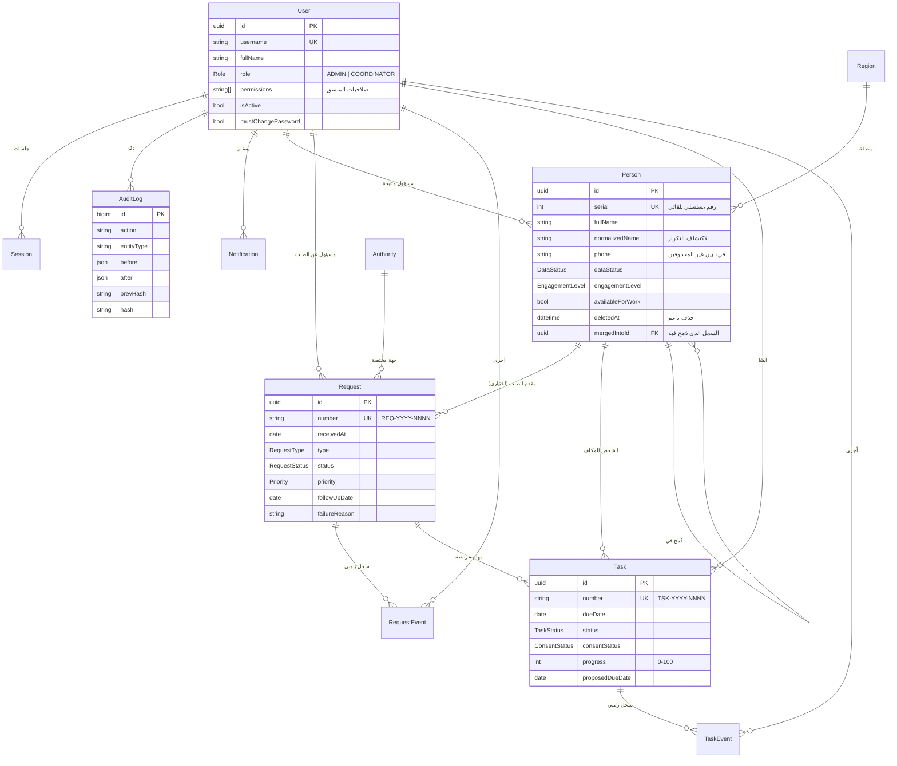

# تصميم قاعدة البيانات

قاعدة بيانات علائقية مركزية (PostgreSQL) تُدار بـ Prisma. صُمِّم المخطط **لجميع المراحل منذ المرحلة الأولى** حتى لا تتغير البنية الأساسية عند إضافة الوحدات لاحقاً. التعريف الكامل في [`prisma/schema.prisma`](prisma/schema.prisma)، والترحيلات في `prisma/migrations/`.

## مخطط العلاقات

## الجداول

| الجدول | الغرض | المرحلة التي تستخدمه |
|---|---|---|
| `User` | الحسابات (مدير النظام، المنسق العام) وصلاحيات المنسق | 1 |
| `Session` | جلسات الدخول (يُخزَّن تجزيء الرمز فقط) | 1 |
| `LoginAttempt` | محاولات الدخول لتحديد المعدل وكشف التخمين | 1 |
| `AuditLog` | سجل التدقيق الإلحاقي المتسلسل بالتجزئة | 1 |
| `Region` | المحافظات/المناطق (19 محافظة مزروعة مسبقاً) | 1 (الإدارة)، 2 (الاستخدام) |
| `Authority` | الجهات المختصة التي تُحال إليها الطلبات | 1 (الإدارة)، 3 (الاستخدام) |
| `Setting` | الإعدادات القابلة للتعديل (مدة القفل، مدة عدم التحديث، أيام التنبيه) | 1 |
| `Counter` | الترقيم السنوي للطلبات والمهام دون تكرار | 3 |
| `Person` | قاعدة بيانات الأشخاص | 2 |
| `Request` / `RequestEvent` | الطلبات وسجلها الزمني | 3 |
| `Task` / `TaskEvent` | المهام وموافقة المكلف وسجلها الزمني | 3 |
| `PersonDistinctPair` | أزواج السجلات المؤكد أنها لشخصين مختلفين، فلا تظهر في مراجعة التكرار | 2 |
| `Notification` | التنبيهات الداخلية (دون تكرار بفضل `dedupeKey`) | 4 |

## القيم المرجعية

- **حالة البيانات** `DataStatus`: مكتملة، ناقصة، بانتظار التحديث.
- **مستوى التفاعل الإداري** `EngagementLevel`: مرتفع، متوسط، منخفض، غير متفاعل.
- **نوع الطلب** `RequestType`: إداري، خدمي عام، استفسار، متابعة معاملة، آخر.
- **حالة الطلب** `RequestStatus`: جديد، قيد المراجعة، محال إلى الجهة المختصة، قيد المتابعة، منجز، متعذر، مغلق.
- **حالة المهمة** `TaskStatus`: لم تبدأ، قيد التنفيذ، بانتظار رد، منجزة، متعثرة، ملغاة.
- **موافقة المكلف** `ConsentStatus`: بانتظار الموافقة، وافق، اعتذر، طلب تعديل الموعد. المهمة لا تصبح تكليفاً نافذاً إلا بعد «وافق».

## الحماية على مستوى قاعدة البيانات

هذه القيود مفروضة في قاعدة البيانات نفسها (الترحيل `audit_protection`)، فلا يمكن تجاوزها حتى بخطأ في الشيفرة:

1. **سجل التدقيق إلحاقي فقط**: مشغّلات تمنع `UPDATE` و`DELETE` و`TRUNCATE` على `AuditLog`. كل قيد يحمل تجزئة SHA-256 للقيد السابق، فأي تعطيل للمشغّل والعبث بالقيود يُكشف بزر «التحقق من سلامة السجل».
2. **السجلات الزمنية للطلبات والمهام** (`RequestEvent`، `TaskEvent`) لا تُعدَّل ولا تُحذف.
3. **رقم الهاتف** فريد بين السجلات غير المحذوفة (فهرس جزئي)، ويُسمح بإعادة استخدامه بعد الحذف الناعم.
4. **نسبة الإنجاز** بين 0 و100 (قيد CHECK).
5. **البحث التقريبي**: إضافة `pg_trgm` مع فهرس GIN على الاسم الموحد لاكتشاف الأسماء المتشابهة بسرعة.
6. **الحذف ناعم** للأشخاص والطلبات والمهام (`deletedAt`)، فيمكن استعادة أي سجل حُذف بالخطأ.

## ما لا يُخزَّن

لا توجد حقول للانتماء أو الآراء أو التفضيلات، ولا يُستخدم مستوى التفاعل لأي تقييم سياسي. الملاحظات مخصصة للمعلومات الإدارية غير الحساسة فقط. كلمات المرور تُخزَّن بتجزئة Argon2id، ورموز الجلسات بتجزئة SHA-256، ولا تُسجَّل أي قيمة سرية في سجل التدقيق.
